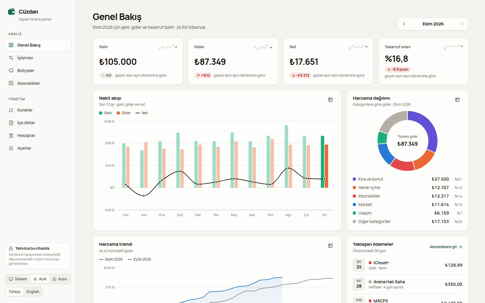
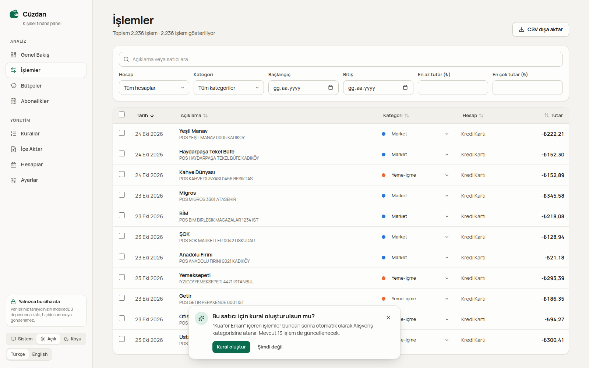
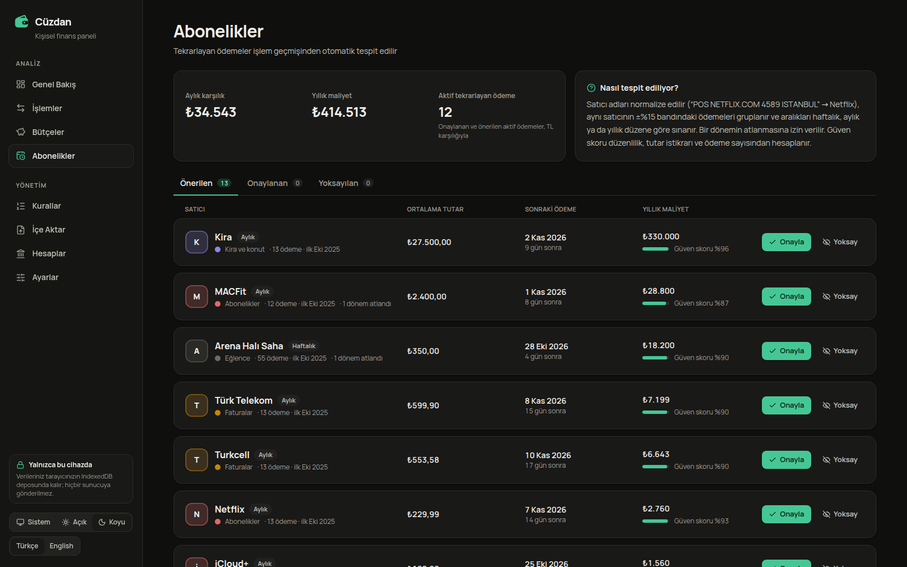
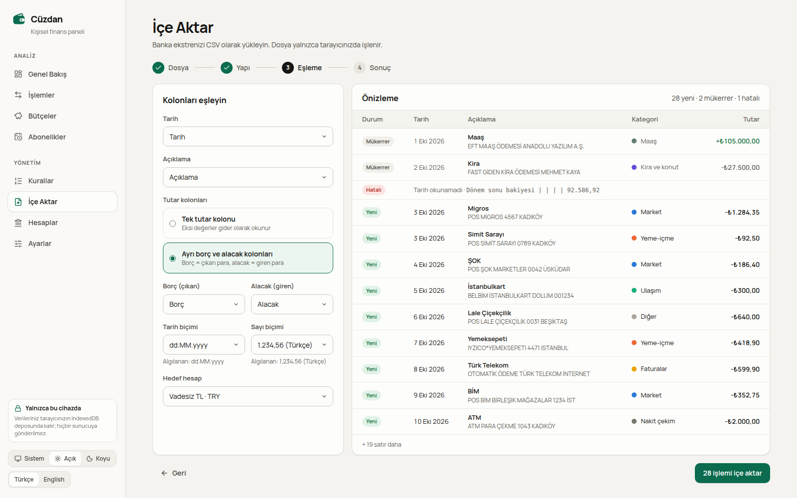
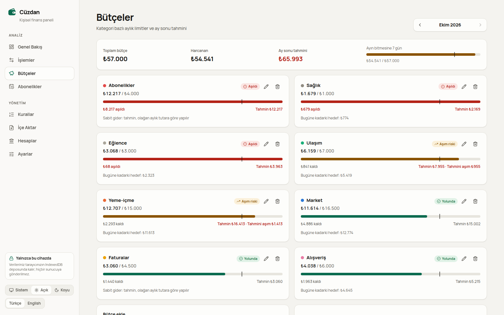
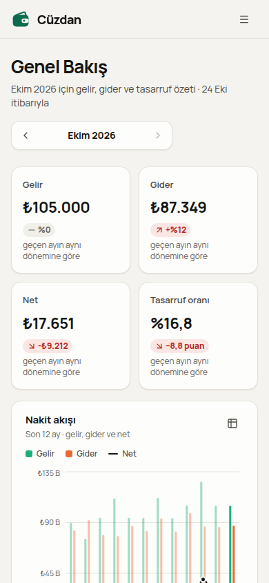

# Cüzdan

**Banka ekstrelerinizi içe aktaran, harcamaları otomatik kategorileyen, bütçe ve abonelikleri takip eden; tüm verileri yalnızca tarayıcınızda tutan kişisel finans paneli.**

**Canlı demo:** https://nurullahmencik.github.io/cuzdan-finans/

İlk açılışta, açılış tarihinize göre üretilmiş 12 aylık gerçekçi bir örnek veri seti (2.000+ işlem) yüklenir; panel hemen keşfedilebilir. Kendi ekstrenizle başlamak için **Ayarlar → Tüm verileri sil** yeterli.



| İşlemler ve kural önerisi | Abonelik tespiti (koyu tema) |
| --- | --- |
|  |  |
| **İçe aktarma önizlemesi** | **Bütçeler ve ay sonu tahmini** |
|  |  |

<p align="center"></p>

## Gizlilik: local-first

- **Sunucu yok.** Uygulama statik dosyalardan ibarettir; ekstreler, kurallar ve bütçeler tarayıcının **IndexedDB** deposunda (Dexie) tutulur.
- **Ağ isteği yok.** Analitik, izleme ya da harici API kullanılmaz. Yazı tipi pakete gömülüdür; döviz kurları internetten çekilmez, ayarlardan düzenlenir.
- **Dosyalar cihazdan çıkmaz.** CSV ayrıştırma, kategorileme ve mükerrer kontrolü tarayıcıda yapılır.
- Her yazma Dexie `liveQuery` ile tüm sayfalara anında yansır; veriler sayfa yenilendiğinde kalıcıdır, tek tıkla silinebilir veya örnek veriye sıfırlanabilir.

## Özellikler

**Genel Bakış**
- Seçili ayın gelir, gider, net ve tasarruf oranı; önceki aya göre değişim. Ay devam ediyorsa karşılaştırma *geçen ayın aynı dönemiyle* yapılır.
- 12 aylık nakit akışı (gelir/gider çubukları + net çizgisi; çubuğa tıklayınca o ay seçilir), kategori dağılımı (donut), ay içi kümülatif harcama trendi (geçen ayla karşılaştırmalı).
- Bütçe uyarıları ve önümüzdeki 30 günün beklenen tekrarlayan ödemeleri.
- Her grafiğin bir **tablo görünümü** vardır; hiçbir değer yalnızca renk ya da fareyle üzerine gelme ile okunmaz.

**İşlemler**
- TanStack Table + TanStack Virtual ile sanallaştırılmış tablo: 2.000+ satır akıcı kayar; mobilde kart listesine dönüşür.
- Arama (büyük/küçük harf ve Türkçe karakter duyarsız), hesap, kategori, tarih ve TL tutar aralığı filtreleri; filtreler URL'de tutulur.
- Satır içinde kategori değiştirme → **“Bu satıcı için kural oluşturulsun mu?”** önerisi, kaç işlemin etkileneceğiyle birlikte.
- Shift ile aralık seçimi, toplu kategori atama, CSV dışa aktarma (TR'de `;` ve `1.234,56`, Excel uyumlu BOM).

**Bütçeler** — Kategori bazlı aylık limit, ilerleme çubuğu üzerinde “bugüne kadarki hedef” işareti, ay sonu tahmini, aşım ve aşım riski uyarıları.

**Abonelikler** — Tekrarlayan ödemeler otomatik bulunur: periyot, ortalama tutar, sonraki beklenen tarih, yıllık maliyet ve güven skoru. Onayla / yoksay / geri al.

**Kurallar** — “İçerir”, düzenli ifade ve tutar aralığı kuralları; sürükle-bırak (fare, dokunmatik) ve klavye (↑/↓) ile öncelik sırası; kaydetmeden önce **kaç işlemi etkileyeceğinin önizlemesi**; silmede geri al.

**İçe Aktar** — Dört adımlı sihirbaz: dosya → yapı → eşleme → sonuç.
- Kodlama (UTF-8 / **Windows-1254**), ayraç, başlık satırı, kolonlar, tarih biçimi (`dd.MM.yyyy`, `yyyy-MM-dd`, `dd/MM/yyyy`) ve ondalık biçimi (`1.234,56` / `1,234.56`) otomatik algılanır, hepsi elle değiştirilebilir.
- Tek tutar kolonu ya da ayrı borç/alacak kolonları.
- Önizlemede her satır *Yeni / Mükerrer / Hatalı* olarak işaretlenir, kategori tahmini gösterilir.
- [`public/ornek-ekstre.csv`](public/ornek-ekstre.csv): Türk bankası biçiminde (Windows-1254, `;`, açıklama satırları, bakiye kolonu, dipnot satırı) indirilebilir örnek dosya.

**Hesaplar** — Vadesiz TL, Kredi Kartı, USD Hesabı (yenileri eklenebilir). Ana para birimi TRY; USD/EUR tutarlar işlemin ayına ait, **ayarlardan düzenlenebilen aylık kurla** çevrilir.

**Genel** — Türkçe (varsayılan) ve İngilizce arayüz, locale'e göre para/tarih biçimleri (`₺1.234,56` / `₺1,234.56`); sistem temasını izleyen, elle değiştirilebilen açık/koyu tema; klavye ile tam kullanım, görünür odak halkası, “içeriğe geç” bağlantısı.

## Mimari ve teknik kararlar

```
UI (React 19, React Router)          ← sayfalar yalnızca okur ve repo fonksiyonlarını çağırır
   │  useData() / useMonth() / useI18n()
DataProvider ── Dexie liveQuery ──► IndexedDB      (yazma: src/db/repo.ts)
   │
src/lib  ← saf TypeScript: CSV, satıcı normalizasyonu, kurallar, tekrar tespiti,
           bütçe tahmini, kur çevrimi, analitik, örnek veri. React'ten bağımsız, birim testli.
```

- **Saf alan mantığı.** Tüm hesaplamalar `src/lib` altında, framework'ten bağımsız fonksiyonlardır; Vitest ile doğrudan test edilir. Bileşenler bu fonksiyonları `useMemo` ile çağırır.
- **Tek veri kaynağı.** `DataProvider` her tabloya `liveQuery` ile abone olur; herhangi bir yazma tüm sayfalara yansır. Güncellemeler `startTransition` içinde uygulanır, böylece büyük render'lar parçalanır.
- **Kategorileme.** Kurallar öncelik sırasıyla denenir, ilk eşleşen kazanır; hiçbiri eşleşmezse işaretine göre *Diğer* / *Diğer gelir*. Elle seçilen kategori “yapışkandır”, hiçbir kural ezmez. Elle düzeltmeden öğrenme: düzeltilen satıcı için en yüksek öncelikli bir “içerir” kuralı önerilir; mevcut kurallar zaten aynı sonucu veriyorsa öneri çıkmaz.
- **Satıcı normalizasyonu.** Açıklama Türkçe harflerden arındırılıp büyük harfe çevrilir, bilinen satıcılar sözlükle eşlenir (`POS NETFLIX.COM 4589 ISTANBUL` → *Netflix*). Diğerlerinde işlem öneki, ödeme aracısı (`IYZICO*`), kart/terminal numarası, tarih, alan adı, şehir ve şirket ekleri ayıklanır. Ayıklama karakter konumlarını koruyarak yapıldığı için kalan kelimeler orijinal Türkçe harfleriyle okunur (`POS ESNAF LOKANTASI 0088 ATAŞEHİR` → *Esnaf Lokantası*).
- **Mükerrer tespiti.** Karma = tarih + tutar + normalize açıklama. Sayım tabanlıdır: hesapta bir “SİMİT SARAYI 45,00” varken dosyada aynı gün iki tane varsa, biri yeni kabul edilir (gerçekten iki kez alışveriş yapılmış olabilir).
- **Bütçe tahmini.** Değişken giderlerde *harcanan / geçen gün × ayın gün sayısı*; ayın ilk üçte birinde tek bir büyük alışverişin tahmini şişirmemesi için son üç ayın ortalamasıyla harmanlanır. Kira, fatura, abonelik gibi sabit giderler doğrusal büyütülmez; olağan aylık tutar esas alınır.
- **Performans.** Rotalar ve Recharts tembel yüklenir; örnek veri **Web Worker** içinde üretilip IndexedDB'ye yazılır; Genel Bakış veri gelmeden başlık ve iskeletini çizer (layout kayması yok). Lighthouse mobilde Genel Bakış'ta LCP 0,8 sn, CLS 0.
- **GitHub Pages.** `base: '/cuzdan-finans/'` ve React Router `basename`; derleme sonunda `index.html` → `404.html` kopyalanır, böylece derin bağlantılar (ör. `/cuzdan-finans/transactions`) çalışır.
- **Tip güvenliği.** TypeScript `strict` + `noUncheckedIndexedAccess`; çeviri anahtarları tiplidir (eksik İngilizce anahtar derleme hatasıdır); dosya ve form verisi IndexedDB'ye yazılmadan önce Zod ile doğrulanır.

### Tekrarlayan ödeme tespiti

[`src/lib/recurrence.ts`](src/lib/recurrence.ts)

1. **Grupla.** Giderler normalize satıcı anahtarı + para birimine göre gruplanır (gelirler ve hesaplar arası transferler hariç).
2. **Tutar kümeleri.** Her ödeme, son tutarı **±%15** içinde olan kümeye katılır; zincirleme olduğu için kademeli zamlar (209,99 → 229,99) tek seride kalır, aynı satıcının farklı abonelikleri (79,99 ve 399,99) ayrı serilere ayrılır.
3. **Periyot sınaması.** Ardışık aralıklar haftalık (7 ± 1,5 gün), aylık (30,44 ± 5 gün) ve yıllık (365,25 ± 20 gün) düzene karşı sınanır. Bir aralık iki periyoda denk geliyorsa **bir atlanan dönem** sayılır; en fazla bir atlamaya izin verilir.
4. **Güncel dizi.** Son ödemeden geriye doğru, aralıklar uyduğu sürece ilerlenir. Ayrıca kümedeki aralıkların en az %60'ı düzene uymalıdır. En az ödeme sayısı: haftalık 5, aylık 3, yıllık 2.
5. **Güven skoru** = 0,4 × düzenlilik + 0,3 × tutar istikrarı + 0,3 × ödeme sayısı desteği − atlanan dönem cezası − **gürültü cezası**. Gürültü, aynı satıcının dizi aralığındaki diğer ödemeleridir: haftada birkaç kez gidilen bir markette rastlantısal olarak düzenli görünen alt diziler böylece elenir. Skoru 0,5'in altındaki diziler gösterilmez.
6. **Sonuç.** Sonraki tarih aylıkta en sık görülen fatura gününe göre hesaplanır (hafta sonu kaymaları kalıcı olmaz). Beklenen tarihten belirgin biçimde geçmiş diziler *durmuş olabilir* olarak işaretlenir; ancak satıcı o tarihte farklı bir tutarla ödeme aldıysa (mevsimsel doğalgaz faturası, büyük zam) eski küme “bayat” sayılır ve listelenmez.

Testlerde aylık, haftalık ve yıllık ödemeler, tutar oynaması, atlanan ay, iptal edilen abonelik ve yanlış pozitif örnekleri (değişken market alışverişleri, düzensiz aralıklı sabit tutarlı İstanbulkart dolumları, maaş ve transferler) ayrı ayrı doğrulanır.

### Örnek veri

[`src/lib/seed/generate.ts`](src/lib/seed/generate.ts) tohumlu bir RNG (mulberry32) ile, açılış tarihine göre son 12 ayı üretir: Ocak ve Temmuz zamlı maaş, kira, mevsimsel elektrik/su/doğalgaz, internet ve mobil hat; Migros, A101, BİM, ŞOK, fırın, manav; Yemeksepeti, Getir, kafeler, öğle yemekleri; İstanbulkart dolumları ve akaryakıt; Netflix (zamlı), Spotify, YouTube Premium, iCloud+, yaz tatilinde dondurulan spor salonu, iptal edilmiş Disney+, haftalık halı saha, USD hesabında GitHub, AWS ve yıllık JetBrains lisansı; Trendyol ve Hepsiburada, Efsane Cuma ve yılbaşı alışverişi, bayram öncesi giyim ve tatlı alışverişi, Ağustos'ta Bodrum tatili. Aynı gün için çıktı her zaman aynıdır.

## Klasör yapısı

```
src/
├── app/            Uygulama kabuğu, yönlendirme, sağlayıcılar (veri, ay, tema, bildirim)
├── components/     Paylaşılan arayüz parçaları (Button, Card, Field, Tabs, Meter, ...)
├── db/             Dexie şeması, repository fonksiyonları, örnek veri worker'ı
├── domain/         Tipler, kategori tanımları, Zod şemaları
├── features/       Sayfalar: overview, transactions, budgets, subscriptions,
│                   rules, import, accounts, settings
├── i18n/           Türkçe/İngilizce sözlükler, locale'e duyarlı biçimlendiriciler
└── lib/            Saf alan mantığı ve birim testleri
    ├── csv/        Kodlama, ayraç/başlık/kolon algılama, sayı ve tarih ayrıştırma
    └── seed/       Tohumlu RNG, örnek veri üreticisi, başlangıç kuralları
e2e/                Playwright testleri ve ekran görüntüsü senaryoları
public/             ornek-ekstre.csv, favicon
scripts/            Örnek ekstre üreticisi (Windows-1254)
docs/screenshots/   README görselleri
```

## Çalıştırma ve test

Gereksinim: Node 22+.

```bash
npm install
npm run dev            # http://localhost:5303/cuzdan-finans/

npm run lint           # ESLint (0 uyarı sınırı)
npm run typecheck      # tsc -b
npm test               # Vitest birim testleri
npm run build          # üretim derlemesi → dist/
npx playwright install chromium
npm run e2e            # Playwright, üretim derlemesine karşı (vite preview)
npm run screenshots    # docs/screenshots görsellerini yeniden üretir
npm run sample:csv     # public/ornek-ekstre.csv dosyasını yeniden üretir
```

**Kalite kapısı** (CI'da her push'ta çalışır, `.github/workflows/ci.yml`):

| Kontrol | Sonuç |
| --- | --- |
| ESLint (`--max-warnings 0`) | 0 hata, 0 uyarı |
| TypeScript (strict) | temiz |
| Vitest | 7 dosya, 100 test |
| Playwright (üretim derlemesi) | 13 test |
| Lighthouse mobil, Genel Bakış (3 ölçüm) | Performance 95–99 · Accessibility 100 · Best Practices 100 |
| Lighthouse mobil, diğer 7 sayfa | Performance 90–94 · Accessibility 100 · Best Practices 100 |
| axe-core WCAG 2 A/AA (8 sayfa × açık/koyu tema) | 0 ihlal |

Playwright senaryoları: örnek CSV'yi sihirbazla içe aktarma ve ikinci denemede tüm satırların mükerrer sayılması; kategori değiştirip kural oluşturma; genel bakış grafiklerinin render edilmesi ve tablo görünümü; yenilemeden sonra veri ve tema kalıcılığı; İngilizceye geçiş; 375 px'te sekiz sayfanın hiçbirinde yatay kaydırma olmaması. E2E testleri saati sabitler, böylece göreli üretilen örnek veri her çalıştırmada aynıdır.

**Dağıtım:** `main` dalına her push'ta `.github/workflows/deploy.yml` derleyip GitHub Pages'e yayınlar.

## Teknolojiler

React 19 · TypeScript (strict) · Vite · Tailwind CSS v4 · React Router · TanStack Table v9 · TanStack Virtual · Recharts (tembel yüklenir) · Dexie (IndexedDB) · PapaParse · date-fns (tr) · Zod · lucide-react · Vitest · Playwright

## Lisans

[MIT](LICENSE) © 2026 Nurullah Mencik

---

### English summary

**Cüzdan** (“wallet”) is a local-first personal finance dashboard: import bank statements as CSV, get transactions categorized automatically, and track budgets and subscriptions. There is no backend and no network traffic; everything lives in the browser's IndexedDB.

- **Import wizard** that auto-detects UTF-8 vs Windows-1254 (common in Turkish bank exports), delimiter, header row, column mapping, date and decimal formats, with an occurrence-aware duplicate check.
- **Rules engine** (contains / regex / amount range) with drag-and-drop and keyboard priority ordering, a pre-save impact preview, and *learning from corrections*: fixing a category offers a merchant rule.
- **Recurring payment detection**: merchant normalization, ±15% amount clustering, weekly/monthly/yearly cadence tests with one skipped period allowed, and a confidence score that penalizes noisy merchants to avoid false positives.
- **Budgets** with month-end forecasts that do not extrapolate fixed costs, **multi-currency** accounts converted with editable monthly rates, a virtualized 2,000+ row transactions table, Turkish/English UI and light/dark themes.
- Quality: strict TypeScript, ESLint with zero warnings, 100 Vitest unit tests, 13 Playwright tests against the production build; Lighthouse mobile on the overview 95–99 performance, 100 accessibility, 100 best practices.

Live demo: https://nurullahmencik.github.io/cuzdan-finans/ · Run locally with `npm install && npm run dev`.
